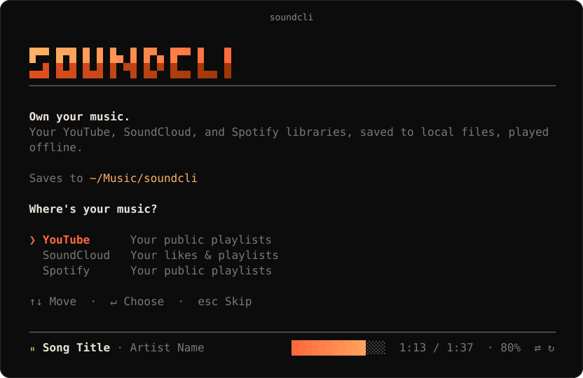
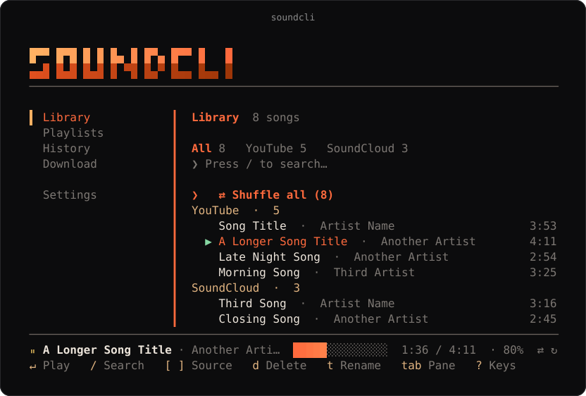
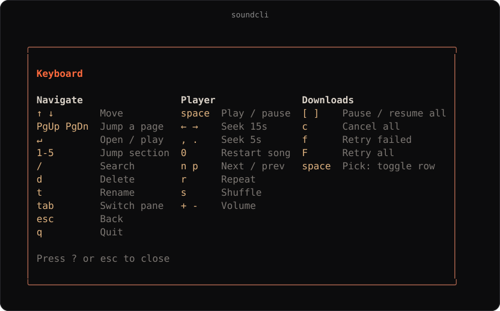

<p align="center">
  
</p>

Own your music. soundcli downloads your YouTube, SoundCloud, and Spotify libraries to your computer and plays them offline, straight from your terminal. Every song lands on your own drive as a real file, yours to keep and ready the moment you want it.

## Get started

You only have to do this once. soundcli handles the rest itself.

1. **Install Node.js** from [nodejs.org](https://nodejs.org): download the installer and click **Next** until it finishes. It's the one piece of software soundcli runs on.
2. **Open your terminal.** On **Windows**, press the Windows key, type `terminal`, and press Enter. On a **Mac**, press `Cmd + Space`, type `terminal`, and press Enter. A plain window opens, and that's all you need to get going.
3. **Start soundcli.** Copy the line below, paste it into the terminal, and press **Enter**:

   ```sh
   npx sndcli
   ```

From there soundcli takes over, downloading the few tools it needs and setting everything up on its own.

## The first run

The first time it opens, soundcli shows you where your music will be saved: a dedicated folder inside your computer's Music folder, so you always know where your files are.

Then it asks where your music comes from. Pick **YouTube**, **SoundCloud**, or **Spotify**, then type your username or paste a link to a playlist, an album, or a single track. Downloading starts right away, and you can begin listening while the rest of your library finishes.

<p align="center">
  
</p>

## Your library, kept in order

Every track downloads at the best quality its source streams in your library's format, with album artwork and artist details included, and gets sorted into folders automatically so your collection stays organized. Almost any link works: playlists, albums, artist profiles, your likes, or a single song. Public Spotify playlists and albums work without signing in, and each of their songs is matched and downloaded from YouTube.

It never downloads the same song twice, and if you close it mid-download, it picks up where it left off next time. A song that can't be downloaded (removed, private, copy-protected) is remembered and left alone instead of failing again on every run. Press `F` in Downloads to try those again. Long YouTube playlists download at a steady pace rather than all at once, because YouTube blocks downloads that come too fast. Once a track is saved, it's there for good. You can rename tracks and playlists directly from the interface to keep everything tidy.

## Playing it back

Everything runs from the keyboard, with controls that are quick to pick up. Press `?` anytime for the full list of keys. The bar along the bottom of the screen only shows the few that matter right now, so there's nothing to memorize.

<p align="center">
  
</p>

## Without the dashboard

soundcli can also download without opening anything, which is what you want from a script, a scheduled task, or another program. Give `add` one or more links and it downloads them, prints what happened, and exits:

```sh
npx sndcli add https://soundcloud.com/artist/track
```

It is the same downloader the dashboard uses, so everything above still holds: songs land in the same folders, nothing downloads twice, and a run that gets cut off picks up where it left off next time. The links you pass go first, ahead of anything an earlier session left unfinished.

A link can be a single song, a playlist, an album, a SoundCloud likes page, or everything an artist has posted (their `/tracks` page on SoundCloud, a channel's `/videos` page on YouTube). A whole profile is a lot of music to pull in by accident, so `add` only takes one when you add `--all`:

```sh
npx sndcli add https://soundcloud.com/artist --all
```

If soundcli is already open, `add` hands the links to it and returns once it has them, usually within a couple of seconds, and the songs show up in its Download section. If you open soundcli while an `add` is still running in the background, that run saves its place and steps aside, and the dashboard carries on with the same downloads.

Run the same line on a schedule to keep a playlist or your likes in step. Each run only fetches what is new.

To follow a link from now on instead, `watch` it. soundcli notes what the link holds today and leaves all of that alone, and `sync` downloads only what shows up later, on every link you watch:

```sh
npx sndcli watch https://soundcloud.com/artist/tracks --into "Liked Songs"
npx sndcli sync
```

`--into` names a folder in your own collection, made if it is not there yet, so an artist's new songs can land right beside your likes. It works on `add` too. Put `sync` on a schedule and one run checks every watched link. `sndcli watch` by itself lists them, and `unwatch` forgets one without touching what it saved.

### For scripts

With `--json`, `add` and `sync` print one JSON object per line:

| Event | When | Fields |
|---|---|---|
| `link` | A link was read and queued | `link`, `tracks`, `new`, `saved`, plus `unavailable` when songs were left alone and `error` when it could not be read |
| `track` | A song finished | `status` (`saved`, `exists` or `failed`), `source`, `title`, `artist`, `file`, plus `reason`, `detail` and `permanent` on a failure |
| `handoff` | The links went to a soundcli that was already running | `owner` (`tui` for the dashboard, `headless` for another `add` or `sync`) |
| `done` | The run is over | `saved`, `exists`, `failed`, `halted`, `exit` |

`done` is always the last line, after a `handoff` too. `halted` is `null` unless the run stopped early, and then it names the reason. Setup messages go to stderr, so stdout carries nothing but these lines.

The exit code says how it ended:

| Code | Meaning |
|---|---|
| 0 | Finished, or handed to a running soundcli. Songs that are gone for good (removed, private, copy-protected) are reported but do not fail the run. |
| 1 | Something failed that another try could fix, a link could not be read, or setup failed. |
| 2 | The command was wrong: no link, an unknown option, or a profile without `--all`. |
| 75 | Stopped early with its place saved, because the site started refusing downloads or the dashboard took over. Run it again later. |
| 130 | Interrupted with Ctrl+C, with its place saved. |
| 143 | Killed by another program, with its place saved. |

## Contributing

Issues and pull requests are welcome. soundcli is TypeScript with an Ink
terminal UI, riding on yt-dlp and mpv.

Run it locally:

1. Clone the repo and open the folder.
2. Install dependencies (Node 22 or newer):
   ```sh
   npm install
   ```
3. Start the dev build, which runs straight from source:
   ```sh
   npm run dev
   ```
   Or build it and run the bundled version:
   ```sh
   npm run build
   npm start
   ```

Before opening a pull request:

- Run the tests: `npm test`
- Check types: `npm run typecheck`
- Write commits in Conventional Commits style (`fix:`, `feat:`, `docs:`, `chore:`, `refactor:`)
- Keep the UI surface minimal: one contextual footer plus the `?` cheatsheet, never a wall of commands

Then open a PR against `main` with a short note on what changed and why.

## Privacy

soundcli runs on your computer and nowhere else. There are no accounts, no logins, and nothing tracking what you play. It connects to the internet for three reasons only: to download the music you ask for, to set itself up the first time, and to keep its own tools current so downloads keep working. Everything else stays with you.
